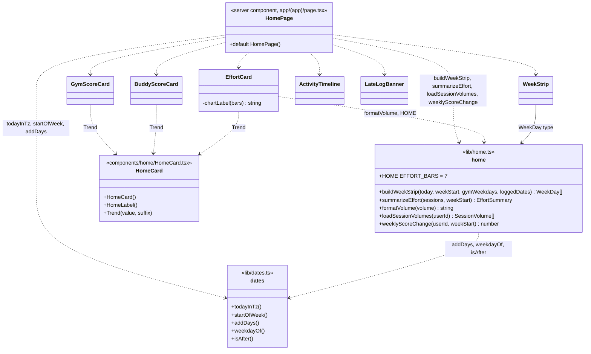
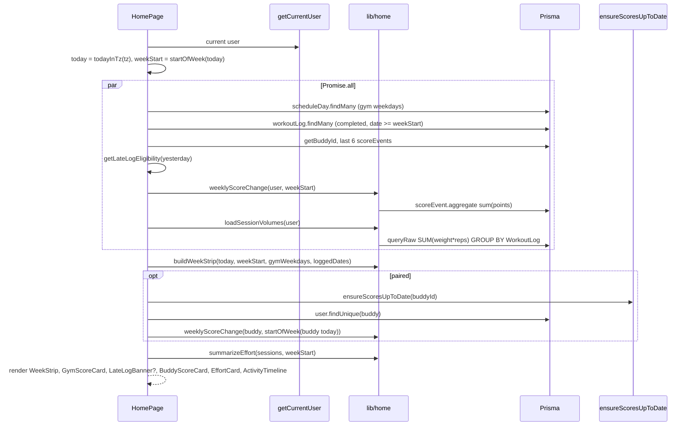
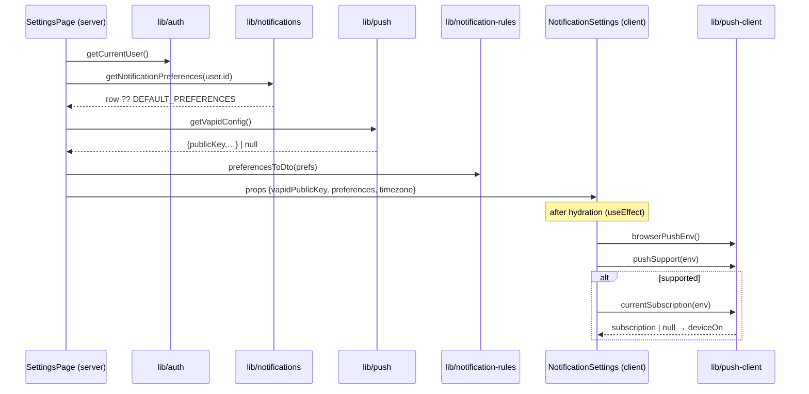
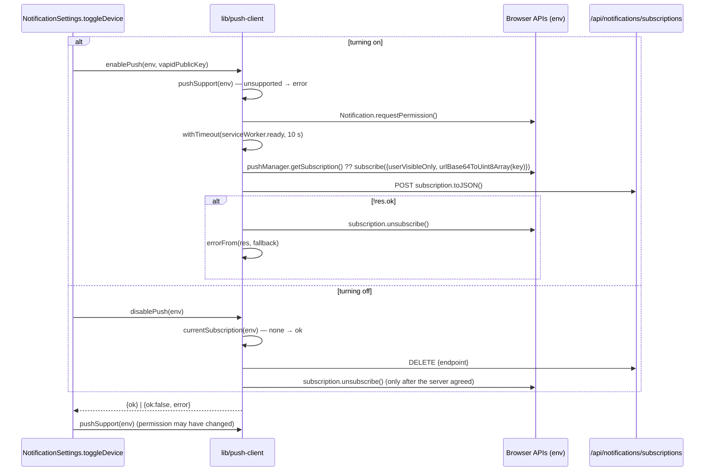
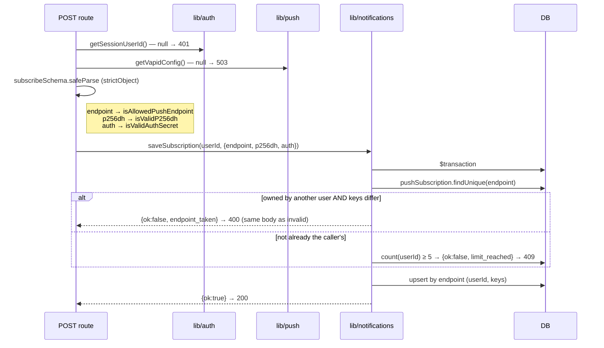
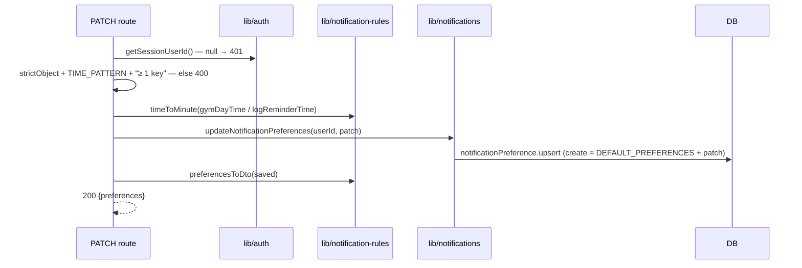
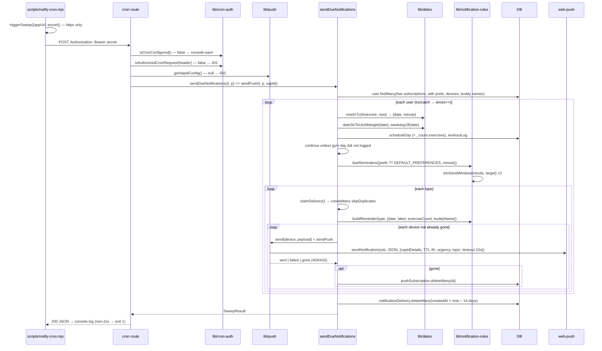
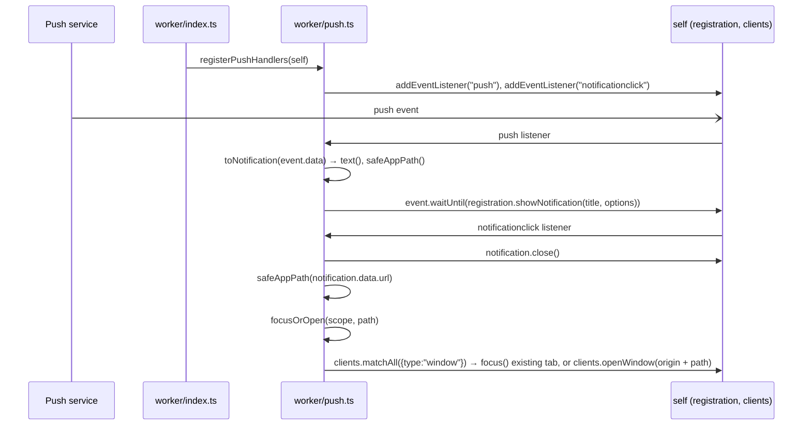

# Duo — Function-level UML

Who calls what, function by function. [`ARCHITECTURE.md`](./ARCHITECTURE.md) explains features at the module level; this file shows the wiring underneath.

**Conventions**
- One section per feature, numbered like the feature's section in ARCHITECTURE.md §9.
- `classDiagram`: each module is a class and its exported functions are methods (`+` exported, `-` private). Arrows mean "calls" (`..>`) or "uses type/constant" (`-->`).
- `sequenceDiagram`: one function's call chain, top to bottom.
- Diagrams are [Mermaid](https://mermaid.js.org/) and render on GitHub and in VS Code.

## Contents

- [9.7 Home](#97-home)
  - [Module map](#module-map-home)
  - [HomePage render](#homepage-render)
  - [Function index](#function-index-home)
- [9.12 Notifications](#912-notifications)
  - [Module map](#module-map)
  - [Settings page → NotificationSettings](#settings-page--notificationsettings)
  - [enablePush / disablePush](#enablepush--disablepush)
  - [POST /api/notifications/subscriptions → saveSubscription](#post-apinotificationssubscriptions--savesubscription)
  - [PATCH /api/notifications/preferences](#patch-apinotificationspreferences)
  - [POST /api/cron/notifications → sendDueNotifications](#post-apicronnotifications--sendduenotifications)
  - [Service worker](#service-worker)
  - [Function index](#function-index)

> The other features (§9.1–9.6, §9.8–9.11) don't have function-level diagrams here yet. Add each one as its own section, following the same conventions.

---

## 9.7 Home

### Module map

### HomePage render

### Function index

| Function | Module | Called by |
|---|---|---|
| `buildWeekStrip` | home | HomePage |
| `summarizeEffort` | home | HomePage |
| `formatVolume` | home | EffortCard (summary + `chartLabel`) |
| `loadSessionVolumes` | home | HomePage |
| `weeklyScoreChange` | home | HomePage (user and buddy) |
| `startOfWeek` | dates | HomePage |
| `Trend` | components/home/HomeCard | GymScoreCard, BuddyScoreCard, EffortCard |
| `HomeCard`, `HomeLabel` | components/home/HomeCard | every home card, LateLogBanner |
| `chartLabel` (private) | components/home/EffortCard | EffortCard |

---

## 9.12 Notifications

### Module map

```mermaid
classDiagram
    direction LR

    class notification_rules["lib/notification-rules.ts (pure)"] {
        +NOTIFICATIONS
        +DEFAULT_PREFERENCES
        +TIME_PATTERN
        +minuteToTime(minute) string
        +timeToMinute(time) number
        +preferencesToDto(prefs) NotificationPreferencesDto
        +isInSendWindow(minute, target) boolean
        +dueReminders(ctx) NotificationType[]
        +buildReminder(type, ctx) PushPayload
    }

    class notifications["lib/notifications.ts"] {
        +getNotificationPreferences(userId)
        +updateNotificationPreferences(userId, patch)
        +saveSubscription(userId, sub)
        +removeSubscription(userId, endpoint)
        +countSubscriptions(userId)
        +sendDueNotifications(send, now) SweepResult
        -claimDelivery(userId, type, date) boolean
    }

    class push["lib/push.ts (server)"] {
        +PUSH_SERVICE_HOSTS
        +isAllowedPushEndpoint(endpoint) boolean
        +isValidP256dh(key) boolean
        +isValidAuthSecret(key) boolean
        +getVapidConfig(env) VapidConfig|null
        +sendPush(target, payload, vapid) SendResult
    }

    class cron_auth["lib/cron-auth.ts"] {
        +MIN_CRON_SECRET_LENGTH
        +isCronConfigured(secret) boolean
        +isAuthorizedCronRequest(authorization, secret) boolean
    }

    class push_client["lib/push-client.ts (browser)"] {
        +browserPushEnv() PushEnv
        +urlBase64ToUint8Array(base64Url) Uint8Array
        +pushSupport(env) PushSupport
        +currentSubscription(env)
        +enablePush(env, vapidPublicKey, timeoutMs) PushResult
        +disablePush(env) PushResult
        -withTimeout(promise, ms)
        -errorFrom(res, fallback)
    }

    class dates["lib/dates.ts"] {
        +nowInTz(timezone, now)
        +dateStrToUtcMidnight(dateStr)
        +weekdayOf(dateStr)
    }

    class worker_push["worker/push.ts (service worker)"] {
        +safeAppPath(url) string
        +toNotification(data)
        +focusOrOpen(scope, path)
        +registerPushHandlers(scope)
        -text(value, max)
    }

    class route_prefs["PATCH /api/notifications/preferences"]
    class route_subs["POST|DELETE /api/notifications/subscriptions"]
    class route_cron["POST /api/cron/notifications"]
    class settings_page["app/(app)/settings/page.tsx"]
    class NotificationSettings["components/settings/NotificationSettings.tsx"]
    class notify_cron["scripts/notify-cron.mjs"] {
        +triggerSweep(appUrl, secret, fetchImpl)
    }
    class web_push["web-push (npm)"] {
        +sendNotification()
    }

    notifications ..> notification_rules : dueReminders, buildReminder
    notifications ..> dates : nowInTz, weekdayOf
    notifications --> push : PushTarget, SendResult types
    push --> notification_rules : PushPayload type
    push ..> web_push : sendNotification

    route_prefs ..> notifications : updateNotificationPreferences
    route_prefs ..> notification_rules : timeToMinute, preferencesToDto
    route_subs ..> notifications : saveSubscription, removeSubscription
    route_subs ..> push : getVapidConfig, isAllowedPushEndpoint, key checks
    route_cron ..> cron_auth : isCronConfigured, isAuthorizedCronRequest
    route_cron ..> push : getVapidConfig, sendPush
    route_cron ..> notifications : sendDueNotifications

    settings_page ..> notifications : getNotificationPreferences
    settings_page ..> push : getVapidConfig (public key only)
    settings_page ..> notification_rules : preferencesToDto
    settings_page --> NotificationSettings : props
    NotificationSettings ..> push_client : enablePush, disablePush, pushSupport
    NotificationSettings ..> route_prefs : fetch PATCH
    push_client ..> route_subs : fetch POST / DELETE
    notify_cron ..> route_cron : fetch POST + Bearer
```

### Settings page → NotificationSettings

### enablePush / disablePush

### POST /api/notifications/subscriptions → saveSubscription

`DELETE` calls `removeSubscription(userId, endpoint)`, which is `deleteMany({ where: { userId, endpoint } })`. It always answers `{ok:true}`.

### PATCH /api/notifications/preferences

### POST /api/cron/notifications → sendDueNotifications

### Service worker

### Function index

| Function | Module | Called by |
|---|---|---|
| `minuteToTime` | notification-rules | `preferencesToDto` |
| `timeToMinute` | notification-rules | preferences route |
| `preferencesToDto` | notification-rules | preferences route, settings page |
| `isInSendWindow` | notification-rules | `dueReminders` |
| `dueReminders` | notification-rules | `sendDueNotifications` |
| `buildReminder` | notification-rules | `sendDueNotifications` |
| `getNotificationPreferences` | notifications | settings page |
| `updateNotificationPreferences` | notifications | preferences route |
| `saveSubscription` | notifications | subscriptions route (POST) |
| `removeSubscription` | notifications | subscriptions route (DELETE) |
| `countSubscriptions` | notifications | tests (available for UI) |
| `claimDelivery` (private) | notifications | `sendDueNotifications` |
| `sendDueNotifications` | notifications | cron route |
| `isAllowedPushEndpoint`, `isValidP256dh`, `isValidAuthSecret` | push | subscriptions route (zod refine); `getVapidConfig` uses `isValidP256dh` |
| `getVapidConfig` | push | subscriptions route, cron route, settings page |
| `sendPush` | push | cron route (as the sweep's `send`) |
| `isCronConfigured`, `isAuthorizedCronRequest` | cron-auth | cron route |
| `nowInTz` | dates | `sendDueNotifications` |
| `browserPushEnv`, `pushSupport`, `currentSubscription` | push-client | NotificationSettings |
| `enablePush`, `disablePush` | push-client | NotificationSettings (`toggleDevice`) |
| `urlBase64ToUint8Array`, `withTimeout`, `errorFrom` | push-client | `enablePush` / `disablePush` |
| `registerPushHandlers` | worker/push | worker/index |
| `toNotification`, `safeAppPath`, `focusOrOpen` | worker/push | the push / notificationclick listeners |
| `triggerSweep` | scripts/notify-cron | its own CLI entry (Railway cron) |
